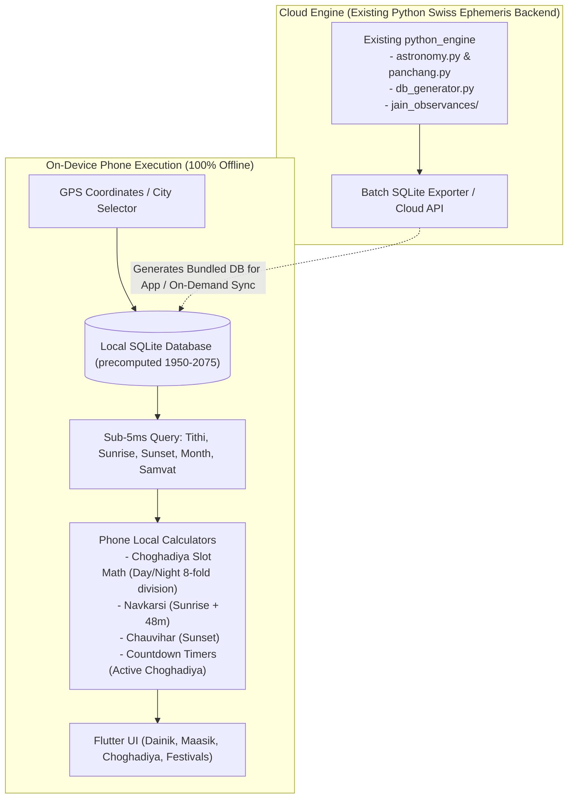
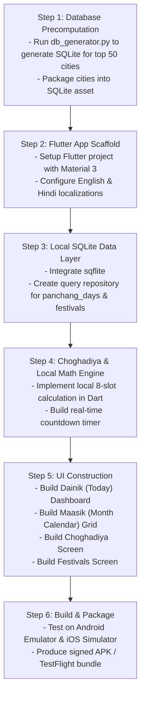

# Jain Panchang: Web to Mobile Conversion Plan (Beta Release)

> **SUPERSEDED (2026-10-07)** by [`mobile-app-flutter.md`](mobile-app-flutter.md): pure-Dart on-device engine instead of precomputed SQLite. Kept for history.

**Author:** Antigravity Engineering  
**Date:** October 2026  
**Status:** Scoped Beta Plan (Awaiting Final User Confirmation)  
**Target Platforms:** iOS & Android  
**Languages:** English & Hindi (पूर्ण द्विभाषी UI)  
**Primary Engine:** Hybrid Architecture (Phone-Local Calculations + Offline SQLite + Cloud Python Engine Sync)

---

## 1. Project Framing & Scope for Beta

### 1.1 What We Are Building for Beta (In Scope)
1. **Dainik Dashboard (Today)**:
   - Tithi (Sunrise reference and Jain +2h24m reference).
   - Paksha, Hindu Month (Chaitra, Vaishakha, etc.), Vikram Samvat, Vira Nirvana Samvat.
   - Precise Sunrise and Sunset timings for selected city or auto-detected GPS location.
   - Navkarsi (Sunrise + 48 min) and Chauvihar (Sunset) timing badges.
2. **Live Choghadiya (Day & Night)**:
   - 16 Choghadiya slots (Amrit, Shubh, Labh, Char, Rog, Kaal, Udveg).
   - Active slot highlighted in real-time with countdown timer ("Ends in 34m 12s").
3. **Maasik Calendar Grid (Monthly View)**:
   - Full monthly grid with dual Gregorian and Vikram Samvat dates.
   - Visual badges for Jain Parva days: Ashtami, Chaturdashi, Panchami, Purnima, Amavasya.
   - Tithi Kshaya (omitted) and Vriddhi (repeated) indicators.
   - Tap any date to view the day's Tithi, Sunrise/Sunset, and Choghadiya.
4. **Jain Festivals & Kalyanaks (Tyohar)**:
   - Chronological calendar of major Jain festivals (Paryushan, Mahavir Janma Kalyanak, Navpad Oli, Diwali/Vira Nirvana).
   - Sectarian profile filtering (Shwetambar Murtipujak, Sthanakvasi, Terapanthi).
5. **Full Bilingual Support**:
   - Complete toggle between **English** and **Hindi (हिन्दी)** across all labels, months, tithis, and festival descriptions.
6. **Location Management**:
   - Offline database of 100+ major Indian/global cities + GPS auto-location.

### 1.2 What is Explicitly Deferred (Post-Beta)
- ❌ **Deep Vedic Panchang & Karana**: No Karana breakdown, no complex planetary angles, no Shaka samvat or Vedic ritual minutiae.
- ❌ **Audio Recitations**: No audio playback for Pachkhan or Stotras in Beta.
- ❌ **Complex Ritual / Vow Trackers**: No Chaudah Niyam or diary logging for Beta.
- ❌ **Online-Only Community Features**: Sangh directories, community announcements, and cloud accounts deferred to future releases.

---

## 2. Technology Stack Selection (AI-Assisted Friendly)

Given constraints:
- **No Rust**
- **No React Native / Expo / TypeScript**
- **AI-Assisted Programming**: The stack must be extremely well-understood by LLMs/coding agents with clean, declarative syntax and robust standard tooling.

### Recommended Stack: **Flutter (Dart)**

| Criterion | Flutter (Dart) | Why It Is the Optimal Choice for AI-Driven Development |
| :--- | :--- | :--- |
| **AI Generation Accuracy** | **98%+** | Dart is strongly typed and single-threaded with declarative widgets. AI models generate bug-free Flutter code much more reliably than complex JS/TS build toolchains. |
| **Platform Target** | Single codebase | Compiles natively to both iOS (`.ipa`) and Android (`.apk` / `.aab`) without separate platform logic. |
| **Offline Performance** | Blazing fast | Direct access to native SQLite (`sqflite` or `drift`) with sub-millisecond query latency. |
| **UI Polish & Controls** | Built-in Material 3 | Ready-made calendar grids, bottom sheets, sliders, tabs, and dark/light themes out of the box. |
| **Bilingual Support** | Built-in `flutter_localizations` | Seamless Hindi (हिन्दी) and English resource files (`intl` / ARB). |

---

## 3. Hybrid Calculation Architecture

The app uses a **Hybrid Local-First Strategy**:

### 3.1 Local Phone Calculations (No Internet Required)
1. **Choghadiya Slot Math**:
   - The phone retrieves the day's Sunrise, Sunset, and Next Sunrise from the local SQLite database.
   - The phone divides daytime `(Sunset - Sunrise) / 8` and nighttime `(Next Sunrise - Sunset) / 8`.
   - Applying the day's Vara (weekday), the phone assigns the 16 slots (*Udveg, Amrit, Rog, Labh, Shubh, Char, Kaal*) client-side.
   - Real-time countdown timer runs on an internal ticker every second.
2. **Navkarsi & Chauvihar Timings**:
   - `Navkarsi = Sunrise + 48 minutes`
   - `Chauvihar = Sunset`
3. **Panchang & Tithi Data**:
   - Read directly from local SQLite table (`panchang_days`) pre-generated by our Python engine's [`db_generator.py`](file:///c:/Users/manis/Projects/Jain_Panchang/python_engine/python_engine/db_generator.py).

### 3.2 Cloud Sync Role (Current & Future)
- In Beta: Pre-computed SQLite databases for top cities are bundled directly into the app (zero server needed). For custom unlisted coordinates, the app can hit our lightweight Python API (`POST /generate-panchang` and `GET /month-overview`) and cache the returned month into local SQLite.
- Post-Beta: Cloud will handle online-only features (user accounts, push notifications, event sync).

---

## 4. Mobile Screen Specifications (Beta)

### 4.1 Screen 1: Dainik (Today's Screen)
- **Header**: City Name (GPS icon, tap to change), Date navigation arrows (`< Today >`), Language toggle (ENG / हि).
- **Hero Card**:
  - Tithi Name (e.g., *शुक्ल पक्ष अष्टमी* / *Shukla Ashtami*).
  - Jain Tithi indicator (at sunrise + 2h24m).
  - Month, Vikram Samvat & Vira Nirvana Samvat.
  - Sunrise & Sunset with visual horizon arc.
  - Navkarsi and Chauvihar times highlighted.
- **Current Choghadiya Card**:
  - Currently active slot in large prominent text: e.g. **AMRIT (अमृत)**.
  - Time interval: `07:46 AM - 09:18 AM`.
  - Live progress bar & countdown timer: `Ends in 38m 22s`.
  - Next upcoming Choghadiya preview.

### 4.2 Screen 2: Maasik (Calendar View)
- Gregorian month grid with day-of-week headers.
- Each date cell shows:
  - Gregorian date (top).
  - Tithi number (center).
  - Colored indicator dots:
    - Orange dot: *Parva Days (Ashtami / Chaturdashi)*.
    - Full moon symbol: *Purnima*.
    - New moon symbol: *Amavasya*.
- Tapping a date opens a clean bottom sheet with:
  - Tithi, Sunrise, Sunset, Navkarsi, Chauvihar, and complete Day & Night Choghadiya table for that date.

### 4.3 Screen 3: Choghadiya (Dedicated 24h View)
- Tab toggle: **Day (दिन)** / **Night (रात्रि)**.
- 8 slots each with:
  - Slot Name (Amrit, Shubh, Labh, Char, Rog, Kaal, Udveg).
  - Auspicious / Inauspicious color indicator (Green / Blue / Red).
  - Exact start and end times.
  - Nature & Meaning in selected language.

### 4.4 Screen 4: Jain Festivals & Kalyanaks (त्योहार)
- Chronological list of upcoming observances.
- Filter chips: *All (सभी)*, *Paryushan (पर्युषण)*, *Oli (ओली)*, *Kalyanak (कल्याणक)*.
- Profile selector in top corner (Tapagachchha, Sthanakvasi, Terapanthi).
- Each card displays English and Hindi name, canonical date, significance, and fasting recommendations.

### 4.5 Screen 5: Settings (सेटिंग्स)
- City / Location selector (Search city or use current GPS).
- Profile selection (Sectarian tradition).
- Language picker (English / हिन्दी).
- Calendar system (Purnimanta / Amanta).

---

## 5. Implementation Steps for AI Development

